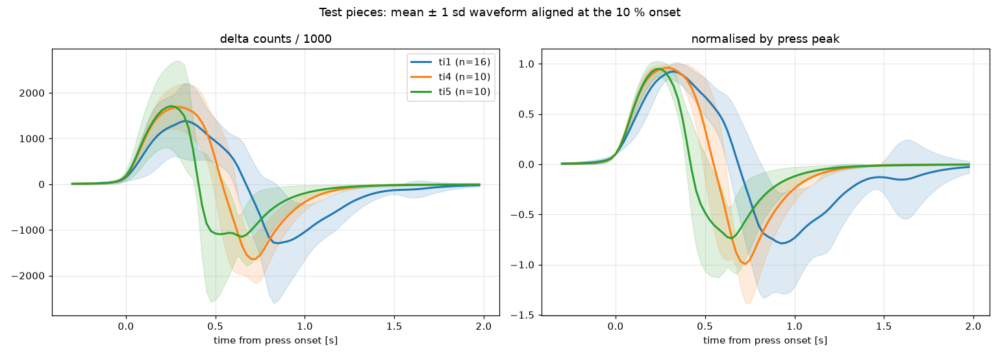

# 試験片 ti1〜ti5 の検証結果（2026-10-21）

手順は [test-pieces-protocol.md](test-pieces-protocol.md)、生データと解析出力は `docs/analysis/2026-10-21-test-pieces/`。

## 1. 何を確かめたか

外形は同じまま、**皮の内側の構造だけ**で圧力波形の形が変わるか。
変われば「指定された外形の中を設計して、1 個の圧力センサーで押した場所を見分ける」方針が成り立つ。

| 片 | 内部 | 計測 |
|---|---|---|
| ti1 | なし（皮 1.5 mm のみ） | ○ 16 回 |
| ti2 | 内側から肉厚 3.0 mm | 未計測 |
| ti3 | 皮の裏に縦リブ | 未計測 |
| ti4 | 皮の裏に 1.5 mm の隙間＋第 2 の膜（床に通気穴） | ○ 10 回 |
| ti5 | 皮の裏に 3.0 mm の隙間＋第 2 の膜（床に通気穴） | ○ 10 回 |

条件: 操作者 1 名、同日・同セッション、TPU 85A、センサーは恐竜と同じ MPS20N0040D + HX710B（40 SPS）、現行ファームウェア、「約 1 秒押して離して 3 秒待つ」を弱・普通・強を混ぜて実施。

## 2. 結果

| 片 | n | 山の高さ (k counts) | 立ち上がり | 山の幅 | 山の減衰 | 谷の幅 | 回復 | 谷/山 |
|---|---:|---:|---:|---:|---:|---:|---:|---:|
| ti1 なし | 16 | 1,152 | 260 ms | 445 ms | **336 ms** | 253 ms | 414 ms | 1.50 |
| ti4 あそび 1.5 | 10 | 1,640 | 201 ms | 412 ms | **116 ms** | 229 ms | 366 ms | 1.13 |
| ti5 あそび 3.0 | 10 | 1,562 | 179 ms | **289 ms** | **140 ms** | 200 ms | 380 ms | 1.11 |

- **3 分類（ti1 / ti4 / ti5、振幅を使わない 12 特徴量、一回抜き最近重心法）: 97.2%。** ペアはそれぞれ 95〜96%。
- 減衰時間の中央値の比: ti1/ti4 = **2.9**、ti1/ti5 = **2.4**。恐竜で安定して当たっているしっぽ／背中の差（谷の幅 2.3 倍）と同等以上。
- 押す強さ（山の高さ）と減衰時間の順位相関は −0.56〜−0.70（強いほど短い）。完全に強さ不変ではないが、強弱を混ぜても分類は 97%。
- 全 36 回とも波形が採用された（INVALID なし）。

**判定: go。** 「皮の裏のあそび」は設計変数になる。

## 3. あそびが波形に与えた影響

- **山がすぐ落ちる。** 皮が第 2 の膜に当たった後は二重構造で硬く、押している間の沈み込み（クリープ）が出ない。指の力が少し抜けると皮が膜から離れ、主室への影響が一気に消える。減衰 336 → 116 ms。
- **谷が早く来る。** 同じ理由で、離したときの立ち下がりが急。
- **あそびの量で山の幅が変わる。** 1.5 mm で 412 ms、3.0 mm で 289 ms。連続的な設計変数として使える。
- **信号は弱くならない。** 山の高さはむしろ大きい。
- **当たるまでは何も起きない（デッドゾーン）。** 軽いタッチは無視される。足は「しっかり押す」前提になる。
- 1.5 と 3.0 の差は 1.4 倍で、2 分類 95%。足 4 本をあそびの量で区別するには刻みが足りない。

## 4. 恐竜 v2 への適用

足 4 本の内側にあそび 2.5 mm のスリーブと通気穴を入れた `3d-models/dino-air-v2-leg-gap.stl`（[reprint-design.md](reprint-design.md) 3f 節）。
頭は変更なし。期待は、頭と足の減衰時間の比 1.0 → 約 3 倍、頭 vs 足の精度 約 50% → 90% 以上、4 分類 85〜95%。

## 5. 制限と残り

- 1 人・1 日・1 セッション。別の人・別の日での再現は未確認。
- ti2（肉厚）と ti3（リブ）は未計測。「硬さだけ」「曲げ剛性」が設計変数になるかは未判定。時間があれば各 10 回で追加できる。
- 平らな試験片の結果で、曲面の足で同じ量の差が出るかは v2 で確認する。
